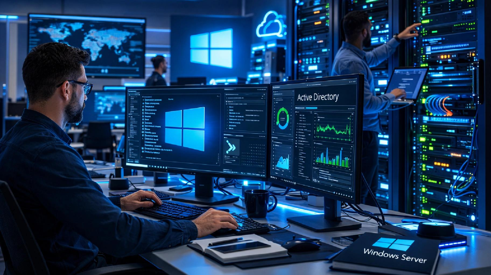

# 👋 Hi, I'm Elsayed Elsamanody

### IT Support | Help Desk | Windows Server | Networking

  
  
  

---

## 👨‍💻 About Me

- Entry-level IT Support candidate interested in IT infrastructure and technical support.
- Hands-on experience building a Windows Server 2025 lab using VMware Workstation.
- Practicing Active Directory, DNS, DHCP, Group Policy, user management, and file sharing.
- Learning network configuration and troubleshooting through Cisco Packet Tracer.
- Background in Front-End Development with experience in HTML, CSS, JavaScript, and React.

---

## 🖥️ Technical Skills

### Operating Systems & Server Administration

### Networking

### Virtualization & Infrastructure

### Additional Skills

---

## 🧪 Practical Labs & Projects

**Windows Server 2025 – IT Infrastructure Lab**

- Active Directory Domain Services (AD DS)
- Domain Controller configuration and domain joining
- DNS and DHCP configuration
- Organizational Units and User Management
- Group Policy configuration and management
- Local Administrator permissions and delegation
- File Server, Shared Folders and NTFS Permissions
- File Server Resource Manager (FSRM)
- Account Lockout Policies and USB Restrictions
- Windows Firewall configuration

**Networking Labs**

- Network configuration using Cisco Packet Tracer
- VLANs, Routing and Switching fundamentals
- DHCP, DNS and Network Troubleshooting

---

## 📚 Currently Learning

- CompTIA A+ — In Progress
- Windows Server Administration
- Active Directory and Group Policy
- Network Troubleshooting and CCNA Topics

---

## 📊 GitHub Statistics

---

## 📫 Connect With Me

---

**Always Learning | Always Troubleshooting | Always Improving**

